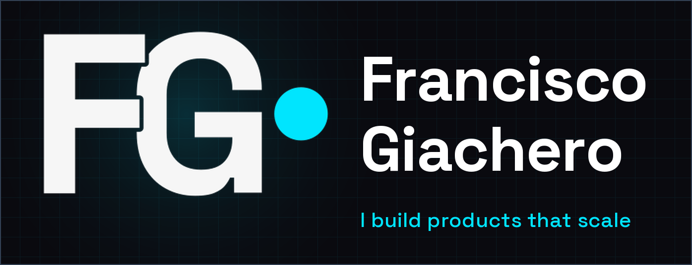

<!--
  Francisco Giachero | GitHub profile README
  Dark/cyan chrome aligned with devfg.com.ar
-->



<div align="center">

<a href="https://devfg.com.ar">
  
</a>

<br/><br/>

[](https://devfg.com.ar)
[](https://www.linkedin.com/in/frangiacherodeveloperweb/)

<br/>

*Fullstack + DevOps + AI. I help companies and startups ship real software, not demos.*

*5+ years building products end to end: interfaces, APIs, infrastructure, and AI-assisted development.*

</div>

```ts
const frandev = {
  name: "Francisco Giachero",
  role: "Senior Software Engineer",
  company: "Vysto AI",
  location: "Argentina 🇦🇷",
  available: true,
  stack: {
    frontend: ["React", "Next.js", "TypeScript", "Astro"],
    backend: ["Node.js", "Express", "FastAPI", "PostgreSQL"],
    mobile: ["React Native", "Expo"],
    ai: ["LangChain", "RAG", "OpenAI", "Claude"],
    devops: ["Docker", "AWS", "Dokploy", "GitHub Actions"],
  },
  openTo: ["freelance", "full-time", "consulting"],
};
```

---

## From code to product

I'm **Francisco Giachero**, a software engineer with 5+ years building and evolving web applications and software systems. My experience spans frontend, backend, APIs, infrastructure, and developer tooling, so I can take a product past a single layer of the stack.

I turn business requirements and problems into simple, maintainable, scalable solutions. I work with React, Next.js, TypeScript, Node.js, and Python, designing interfaces, services, and integrations, and applying principles like SOLID, testing, and sound architecture.

I use AI-assisted development tools such as Claude Code and Cursor to speed up the cycle, inside structured processes like TDD and SDD. The goal is to use AI to build better and faster, without giving up quality, maintainability, or how the software evolves.

<div align="center">


</div>

---

## Where I've been building

<div align="center">

| Company | Title | When |
|:--|:--|:--|
| **[Vysto AI](https://vysto.ai/c/)** | Senior Software Engineer | 2026 — Present |
| **Dewedd** | Frontend Developer | 2024 — 2026 |
| **[Latin Cloud](https://latincloud.com/)** | L1 Operations | 2021 — 2026 |
| **[Freelance](https://devfg.com.ar/)** | Full-Stack Developer | 2020 — Present |

</div>

---

## What I've built

<div align="center">
<sub>Real products, with real users. More on <a href="https://devfg.com.ar/#projects">devfg.com.ar</a>.</sub>
</div>

<br/>

<table>
<tr>
<td width="50%" valign="top">

### Carssnet
 &nbsp;
<kbd>SaaS</kbd> &nbsp; <kbd>PWA</kbd>

A platform that brings services, quotes, and cash flow into one place for auto repair shops.

`React` `Node` `PostgreSQL` `DaisyUI`

</td>
<td width="50%" valign="top">

### Finance Tracking
 &nbsp;
<kbd>Fintech</kbd> &nbsp; <kbd>Dashboards</kbd>

Personal finance app for income, expenses, and yearly metrics.

[Live](https://financetraking.proyectolandia.com.ar)

`React` `Node.js` `MySQL` `Docker`

</td>
</tr>
<tr>
<td width="50%" valign="top">


### Punto Frio
 &nbsp;
<kbd>Catalog</kbd> &nbsp; <kbd>Next.js</kbd>

Digital catalog for a frozen-food business, built so customers can browse quickly.

[Live](https://puntofrio.com.ar/)

`Next.js` `Tailwind` `API REST`

</td>
<td width="50%" valign="top">

### Herrería SG
 &nbsp;
<kbd>Landing</kbd> &nbsp; <kbd>Corporate</kbd>

Company landing page with a gallery of finished work and a direct contact path.

[Live](https://herreriasglbye.com.ar/) · [Repo](https://github.com/Frangia22/HerreriaSGlbye.github.io)

`HTML` `CSS` `JavaScript`

</td>
</tr>
<tr>
<td width="50%" valign="top">

### Laimpresioneta3d
 &nbsp;
<kbd>Catalog</kbd> &nbsp; <kbd>Maker</kbd>

Site for showing 3D printing and laser engraving work, plus custom services.

`Node` `Express` `Docker` `MySQL`

</td>
<td width="50%" valign="top">

### Luz y Fuerza LBYE
 &nbsp;
<kbd>Ops</kbd> &nbsp; <kbd>Django</kbd>

Booking and income/expense tracking for a sports complex.

[Repo](https://github.com/Frangia22/Web-Luz-y-Fuerza)

`Python` `Django` `PostgreSQL`

</td>
</tr>
</table>

---

## Tools of the trade

<div align="center">
<sub>The stack I use in production, not in tutorials.</sub>

<br/><br/>


</div>

---

## How I can help

<div align="center">
<sub>I work with companies and startups that need more than code.</sub>
</div>

<br/>

<table>
<tr>
<td width="50%" valign="top">

### 🌐 Custom web development
<kbd>React</kbd> &nbsp; <kbd>Next.js</kbd> &nbsp; <kbd>Astro</kbd>

Sites and apps built to fit. From landing pages to full SaaS platforms.

</td>
<td width="50%" valign="top">

### ⚙️ Backend & APIs
<kbd>Node.js</kbd> &nbsp; <kbd>Express</kbd> &nbsp; <kbd>PostgreSQL</kbd>

REST APIs, authentication, data, and scalability.

</td>
</tr>
<tr>
<td width="50%" valign="top">

### ☁️ DevOps & deploy
<kbd>AWS</kbd> &nbsp; <kbd>Docker</kbd> &nbsp; <kbd>CI/CD</kbd>

Infrastructure, monitoring, GitHub Actions, and reliable deploys.

</td>
<td width="50%" valign="top">

### 🔍 Technical consulting
<kbd>Architecture</kbd> &nbsp; <kbd>Code Review</kbd> &nbsp; <kbd>Performance</kbd>

Stack choices, reviews, and technical decisions.

</td>
</tr>
</table>

<div align="center">

[Not sure which one you need? Let's talk →](https://devfg.com.ar/#contact)

</div>

---

## Have a project in mind?

<div align="center">

I reply within 24 hours. No endless forms — just tell me what you need.

<br/>

[](https://devfg.com.ar/#contact)
[](https://www.linkedin.com/in/frangiacherodeveloperweb/)

<br/>

<sub>© 2026 FG Dev · Designed and built by me, with pride. 🇦🇷</sub>

</div>
